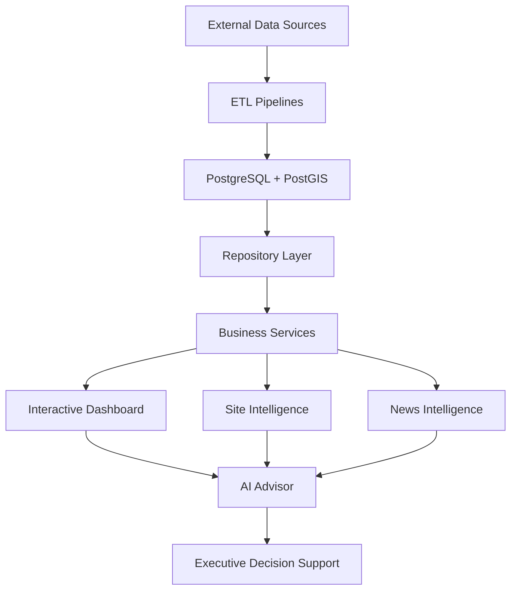

# 🏢 NRW Data Center Business Intelligence Platform

## IRIS-SIG-15 Engineering Assessment — Hamburg Master Planning Geoportal Harvester

This branch contains the implementation for **IRIS-SIG-15: Hamburg Master Planning Geoportal Harvester**. It harvests Hamburg Bebauungsplan records from Hamburg's public structured OGC API, normalizes traceable planning records and representative geometries, and loads them idempotently into `iris_staging.signal_ingest` for PostgreSQL 16 / PostGIS 3.4.

### Assessment quick start

**Prerequisites**

- Python 3.12+
- PostgreSQL 16
- PostGIS 3.4

Create and activate a virtual environment, then install the project and assessment test dependencies:

```bash
python -m venv .venv
```

Windows PowerShell:

```powershell
.\.venv\Scripts\Activate.ps1
python -m pip install -e ".[test]"
```

Linux/macOS:

```bash
source .venv/bin/activate
python -m pip install -e ".[test]"
```

Set the existing repository database environment variable in a local `.env` file (credentials must not be committed):

```text
DATABASE_URL=postgresql+psycopg2://<user>:<password>@localhost:5432/<database>
```

The assessment migration is `alembic/versions/c15a4b7e2d91_create_signal_ingest_staging.py`. The supplied sample repository has a **pre-existing Alembic ancestry gap** (`020c81850f93` references missing revision `7f2c1d8e4a91`), so `alembic upgrade head` cannot be relied on until that upstream history is restored/reconciled. The assessment migration itself was validated against an isolated PostgreSQL 16.15 / PostGIS 3.4.2 database; full details are in the assessment documentation linked below.

Configure a verified collection and run the harvester:

```powershell
$env:HAMBURG_PLANNING_COLLECTIONS="prosin_imverfahren"
python -c "from app.runners.hamburg_planning_runner import run; run()"
```

Run the automated assessment tests:

```bash
python -m pytest tests/hamburg_planning -v
```

Local verification collected **17 tests, all passing**. A live ten-feature run against `prosin_imverfahren` produced 10 staging rows; repeating the same run left the table at 10 rows, demonstrating idempotent duplicate handling. Stored geometry was verified as EPSG:25832.

### Key assumptions and source limitations

- The assignment's Hamburg planning source is consumed through Hamburg's public structured OGC API rather than presentation HTML.
- Verified GeoJSON geometry is treated as EPSG:4326 and transformed to a representative EPSG:25832 point.
- The verified `plan` property is preferred as stable source identity because observed OGC feature IDs were sequential response IDs.
- No plan-level publication date was present in the verified feature shape, so `published_at` remains `NULL` rather than substituting ingestion or catalogue time.
- Domain classification is deterministic and evidence-based. Records without enough source text for port-logistics, grid-heavy-industry, or commercial-zone classification remain explicitly unclassified with a quality warning rather than receiving an inferred category.

### Assessment documentation

See [`docs/hamburg_planning/README.md`](docs/hamburg_planning/README.md) for the complete source contract, setup/run details, field mapping, assumptions, idempotency behavior, tests and limitations.

Supporting deliverables:

- [`docs/hamburg_planning/validation.sql`](docs/hamburg_planning/validation.sql) — validation queries for duplicates, geometry/SRID and quality checks.
- [`docs/hamburg_planning/sample_output.json`](docs/hamburg_planning/sample_output.json) — public-source-derived sample output.
- [`docs/hamburg_planning/quality_report.md`](docs/hamburg_planning/quality_report.md) — concise error/quality report and verified limitations.
- [`tests/hamburg_planning/`](tests/hamburg_planning/) — automated fixture/mock-based test suite.

---

### AI-Powered Geospatial Business Intelligence for Data Center Site Selection and Infrastructure Analysis

The NRW Data Center Business Intelligence Platform is an AI-powered decision support system that combines geospatial analysis, infrastructure intelligence, renewable energy data, market intelligence, and conversational AI into a single interactive dashboard.

Built with **Python**, **PostgreSQL/PostGIS**, **GeoPandas**, **PyDeck**, **Streamlit**, and **OpenAI**, the platform enables users to evaluate data center locations through interactive GIS visualization, site scoring, and AI-assisted insights.

---

## Table of Contents

- [Overview](#overview)
- [Dashboard Preview](#dashboard-preview)
- [Key Features](#key-features)
- [System Architecture](#system-architecture)
- [How It Works](#how-it-works)
- [Dashboard Modules](#dashboard-modules)
- [AI Advisor](#ai-advisor)
- [Technology Stack](#technology-stack)
- [Project Structure](#project-structure)
- [Installation](#installation)
- [Running the Dashboard](#running-the-dashboard)
- [Project Status](#current-project-status)
- [Roadmap](#roadmap)
- [Vision](#vision)

![Python]
![PostgreSQL]
![PostGIS]
![Streamlit]
![OpenAI]
![Status]

## Overview

Selecting an optimal location for a modern data center requires much more than available land.

Power infrastructure, renewable energy, electrical grid capacity, market activity, and surrounding infrastructure all influence the long-term viability of a site.

The NRW Data Center Business Intelligence Platform integrates multiple public infrastructure datasets into a unified PostgreSQL/PostGIS database and provides an interactive AI-powered dashboard for analyzing, comparing, and evaluating potential data center locations.

The platform combines:

- Geospatial Intelligence
- Infrastructure Analysis
- Site Scoring
- Market Intelligence
- AI-assisted Decision Support

# Key Features

## GIS Intelligence

✔ Interactive GIS Infrastructure Map

✔ Data Center Visualization

✔ High Voltage Substations

✔ Transformers

✔ Transmission Lines

✔ Renewable Energy Assets

---

## Business Intelligence

✔ KPI Dashboard

✔ Site Intelligence

✔ Site Score

✔ Market Intelligence

✔ News Intelligence

✔ Spatial Infrastructure Analysis

---

## Artificial Intelligence

✔ AI Advisor

✔ Natural Language Queries

✔ Executive Infrastructure Summaries

✔ Context-aware Responses

✔ Retrieval-Augmented Generation (RAG)

---

## Spatial Intelligence

✔ Power Readiness Analysis

✔ Renewable Energy Analysis

✔ Infrastructure Distance Calculations

✔ Land Value Integration

✔ Site Ranking

# System Architecture


```

┌──────────────────────┐
│ External Data Sources│
└──────────┬───────────┘
           │
           ▼
┌──────────────────────┐
│    ETL Pipelines     │
└──────────┬───────────┘
           ▼
┌──────────────────────┐
│ PostgreSQL + PostGIS │
└──────────┬───────────┘
           ▼
┌──────────────────────┐
│ Repository Layer     │
└──────────┬───────────┘
           ▼
┌──────────────────────┐
│ Business Services    │
└──────────┬───────────┘
           ▼
      ┌────┴────┐
      ▼         ▼
┌──────────┐ ┌──────────┐
│ GIS Map  │ │ News BI  │
└────┬─────┘ └────┬─────┘
     │            │
     └────┬───────┘
          ▼
┌──────────────────────┐
│ Site Intelligence    │
└──────────┬───────────┘
           ▼
┌──────────────────────┐
│ AI Advisor           │
└──────────┬───────────┘
           ▼
┌──────────────────────┐
│ OpenAI GPT           │
└──────────┬───────────┘
           ▼
┌──────────────────────┐
│ Executive Insights   │
└──────────────────────┘
```
```                  

# Dashboard Modules

## Interactive GIS Map

Visualizes:

- Data Centers
- High Voltage Substations
- Transformers
- Renewable Energy Assets
- High Voltage Transmission Lines

---

## KPI Dashboard

Provides executive metrics for infrastructure assets, facilities, and renewable energy resources.

---

## Site Intelligence

Displays infrastructure proximity, renewable energy availability, land valuation, and technical site characteristics for the selected facility.

---

## Site Score

Calculates a unified infrastructure readiness score using spatial analysis and business intelligence metrics.

---

## News Intelligence

Aggregates recent industry news and links relevant articles to companies and facilities.

---

## AI Advisor

Provides conversational access to infrastructure intelligence using natural language.


# AI Advisor

The AI Advisor enables users to explore infrastructure intelligence using natural language.

Current capabilities

- Site Summaries
- Infrastructure Analysis
- Grid Readiness Evaluation
- Renewable Energy Analysis
- Executive Recommendations
- News Summaries

Upcoming

- Intent Detection
- Tool Routing
- Context Awareness
- LangGraph Agents
- Agentic RAG


# Technology Stack

## Backend

- Python
- SQLAlchemy
- PostgreSQL
- PostGIS

## GIS

- GeoPandas
- Shapely
- PyDeck

## Dashboard

- Streamlit

## AI

- OpenAI
- Retrieval-Augmented Generation (RAG)

## Data Processing

- Pandas
- JSON
- GeoJSON

nrw-dc-bi/
│
├── app/
│   ├── services/
│   ├── repositories/
│   ├── database/
│   ├── spatial/
│   ├── intelligence/
│   └── ai/
│
├── ui/
│
├── data/
│
├── scripts/
│
├── tests/
│
└── README.md


# Installation

## Prerequisites

- Python 3.12+
- PostgreSQL 17 + PostGIS
- uv (Python package manager)

Install uv if you don't already have it:

```bash
pip install uv
```

or

```bash
powershell -ExecutionPolicy ByPass -c "irm https://astral.sh/uv/install.ps1 | iex"
```

---

## Clone the Repository

```bash
git clone <repository-url>

cd nrw-dc-bi
```

---

## Create a Virtual Environment

```bash
uv venv
```

Activate it:

### Windows

```bash
.venv\Scripts\activate
```

### Linux / macOS

```bash
source .venv/bin/activate
```

---

## Install Dependencies

```bash
uv sync
```

If you're not using a `uv.lock` yet, then instead use:

```bash
uv pip install -r requirements.txt
```

---

## Configure Environment

```bash
cp .env.example .env
```

Update the database connection and OpenAI API key.

---

## Run Database Migrations

```bash
alembic upgrade head
```

---

## Start the Dashboard

```bash
streamlit run ui/app.py
```

The application will be available at:

```
http://localhost:8501
```

## Requirements

- Python 3.12+
- PostgreSQL 17
- PostGIS
- Git
- uv

# Running the Dashboard

```bash
streamlit run ui/app.py
```
# Current Project Status

## Completed

- Data Collection
- ETL Pipelines
- GIS Dashboard
- Interactive Map
- Site Intelligence
- Site Score
- News Intelligence
- AI Advisor
- Infrastructure Layers

## In Progress

- Context-aware AI
- Intent Detection
- Tool Routing
- LangGraph Integration

## Planned

- Multi-Agent AI
- Predictive Site Recommendations
- Investment Forecasting
- Voice Interface


# Roadmap

## Completed

- ETL Platform
- GIS Visualization
- Business Intelligence Dashboard
- AI Advisor
- News Intelligence

## Next

- Intent Detection
- Context-aware Responses
- Agentic RAG
- LangGraph Workflows

## Future

- Predictive Site Ranking
- Multi-Agent Decision Support
- Voice-enabled AI Advisor


# Vision

The long-term vision is to build an AI-powered decision support platform for data center planning and infrastructure investment.

By combining geospatial intelligence, power infrastructure, renewable energy, land valuation, market intelligence, and conversational AI, the platform enables users to evaluate and compare potential data center locations through natural language interaction.

The project is designed to evolve into a comprehensive executive decision-support system that assists planners, investors, and infrastructure specialists in identifying optimal data center locations.